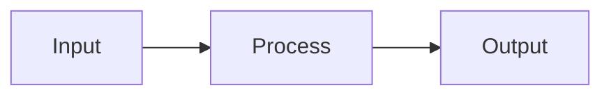

<!--
Writing rules for this board (adapted from Whiteboard's authoring guide):
- Order: what/why -> requirements -> design -> implementation. Omit a section rather than pad it.
- Every section heading is a question. The first line under it is a one-line **bold answer**.
- At most 3 sentences of prose, then a diagram (mermaid sequence / flowchart / erDiagram) or a table.
  If a diagram says the same thing as the prose, keep the diagram.
- Short, plain sentences (~ASD-STE100): one idea per sentence, active voice, no filler.
- Link real code as repo-relative paths with line numbers when it exists.
- Before you finish, read the whole board back and fix contradictions and unverified claims.
- Comments from the reader live in .blackboard/comments.json. Read open ones, answer them by
  editing the docs, and say what changed.
-->

# {{title}} — design

## What are the requirements?

**One sentence: the must-have.**

- Requirement, in the requester's words

## How does it work?

**One sentence: the shape of the solution.**

## What data does it touch?

**One sentence: what is read and written, and where.**

| Store | Read by | Written by |
|-------|---------|------------|
| …     | …       | …          |

## How will we build it?

**One sentence: the order of work.**

1. First small, verifiable step

## How will we know it works?

**One sentence: the proof.**
